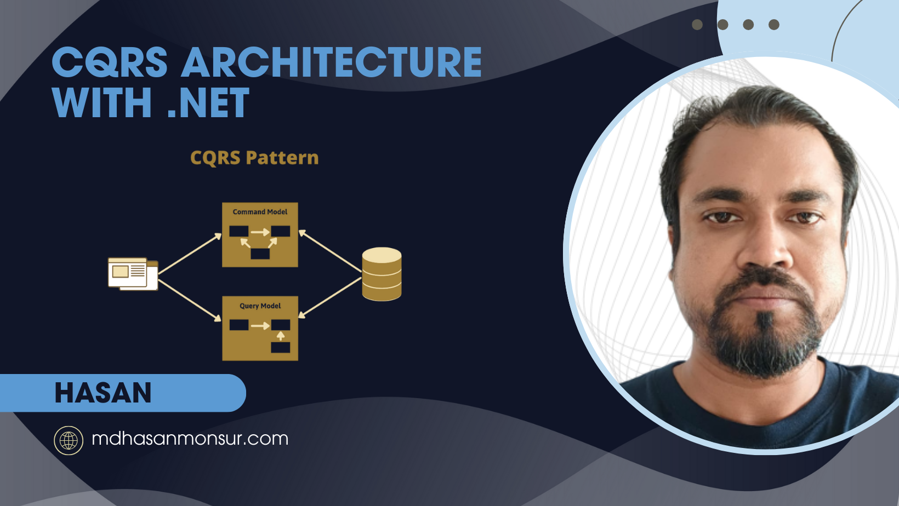
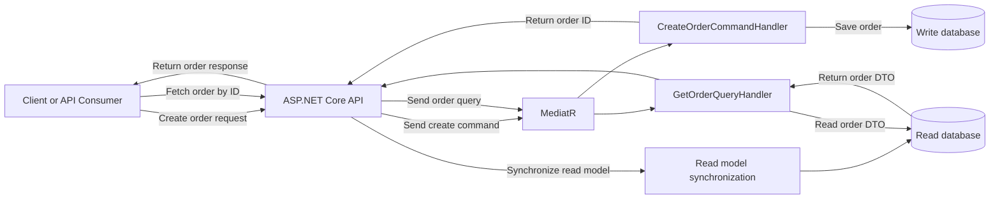
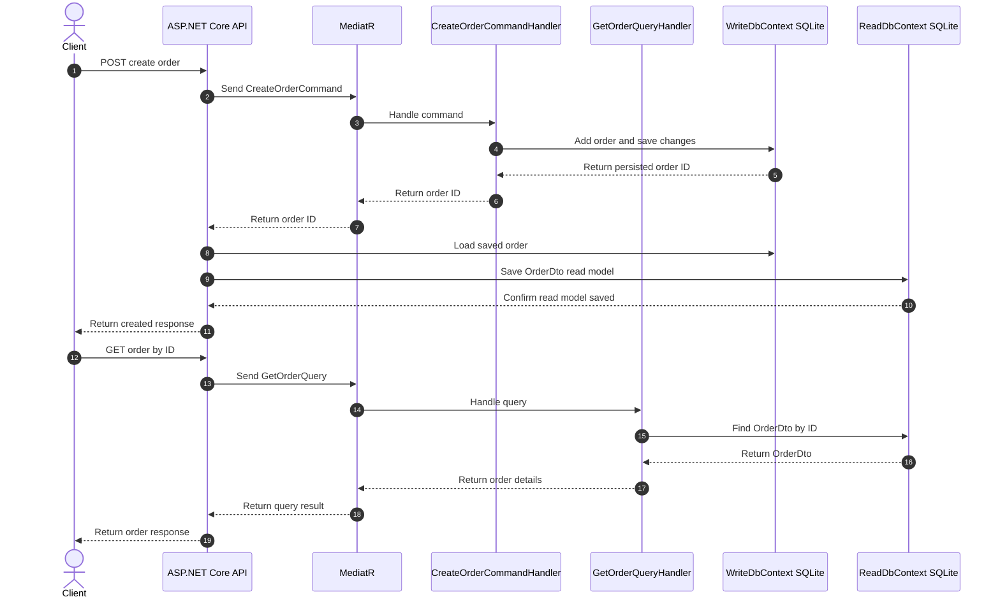

# CQRS Architecture with .NET 9

A practical **CQRS (Command Query Responsibility Segregation)** sample built with **.NET 9**, **ASP.NET Core**, **MediatR**, and **Entity Framework Core**. This project demonstrates a simple read/write database split for an order management scenario, separating commands (writes) from queries (reads) to improve maintainability and scalability.

> This repository is an educational implementation of CQRS patterns in .NET 9. It uses two SQLite databases (write and read), with a direct synchronization step in the endpoint for demonstration purposes.



## Table of contents

- [What this project demonstrates](#what-this-project-demonstrates)
- [Architecture and data flow](#architecture-and-data-flow)
- [Request sequence](#request-sequence)
- [Benefits](#benefits)
- [Use cases](#use-cases)
- [Run locally](#run-locally)
- [Example API flow](#example-api-flow)
- [Project structure](#project-structure)
- [SEO keywords](#seo-keywords)

## What this project demonstrates

This project shows how to organize an application around the CQRS pattern:

- **Commands** handle state-changing operations such as creating an order.
- **Queries** handle read operations such as fetching an order.
- **WriteDbContext** stores the source-of-truth data.
- **ReadDbContext** stores a denormalized, query-optimized read model.
- **MediatR** dispatches commands and queries through handlers.

The application exposes a simple order API and includes the core architectural separation needed to understand CQRS in ASP.NET Core.

## Architecture and data flow



## Request sequence



## Benefits

- **Clear separation of concerns:** command handlers manage writes; query handlers manage reads.
- **Scalability-friendly design:** read and write responsibilities can be optimized independently.
- **Improved maintainability:** business logic stays organized into distinct command and query flows.
- **Better performance tuning:** read models can be shaped specifically for query workloads.
- **Simpler domain logic boundaries:** changes in read requirements do not necessarily affect the write side.
- **Strong learning value:** this project demonstrates CQRS patterns in a .NET service.

## Use cases

This architecture is useful when you need:

- scalable read-heavy systems with a dedicated query model
- command-driven business workflows with clear write boundaries
- cleaner separation between transactional writes and reporting/data access
- domain-driven systems that benefit from explicit command/query responsibilities
- a training project to understand how CQRS differs from traditional CRUD layers

This sample is especially suitable for educational use, prototypes, and internal systems where clear architectural boundaries matter.

## Run locally

### Prerequisites

- .NET 9 SDK
- SQLite

### 1. Restore dependencies

```bash
dotnet restore
```

### 2. Run the application

```bash
dotnet run --project OrderManagement.csproj
```

### 3. Test the endpoints

Create an order:

```bash
curl -X POST http://localhost:5000/orders \
  -H "Content-Type: application/json" \
  -d '{"customerId": 101, "items": ["Laptop", "Mouse"]}'
```

Get an order:

```bash
curl http://localhost:5000/orders/1
```

The actual port may differ depending on your local launch environment.

## Example API flow

### Create order

- Client sends a `CreateOrderCommand` to `/orders`
- The command is handled by `CreateOrderCommandHandler`
- The order is saved to the **write database**
- The read model is manually synced into the read database
- API returns the created order ID

### Get order

- Client sends a `GetOrderQuery` to `/orders/{id}`
- The query is handled by `GetOrderQueryHandler`
- The handler reads from the **read database**
- Response returns a query-optimized `OrderDto`

## Project structure

```text
Commands/                     Command handlers and command contracts
  CreateOrderCommand.cs
  CreateOrderCommandHandler.cs

Data/                         EF Core contexts for read and write stores
  ReadDbContext.cs
  WriteDbContext.cs

Models/                       Domain and query models
  GetOrderQuery.cs
  Order.cs
  OrderDto.cs

Migrations/                   EF Core migration files

Program.cs                    ASP.NET Core app setup and endpoints
OrderManagement.csproj        Project configuration
appsettings.json              App configuration and connection strings
read.db                       SQLite read database
write.db                      SQLite write database
```

## SEO keywords

CQRS architecture .NET 9, CQRS pattern ASP.NET Core, MediatR CQRS example, .NET 9 CQRS repository, read model and write model pattern, command query separation .NET, CQRS tutorial .NET Core, CQRS architecture with SQLite, order management CQRS example.

## Notes

This repository is intentionally compact and focused on demonstrating the CQRS pattern. In production, you would typically replace the direct read model sync with domain events, an outbox pattern, or a background process to keep the read model eventually consistent.
